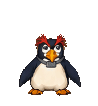
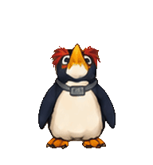

# PEN²

[← All Gukbap's Codex Pets](../../README.md)

## Animated preview


PEN² is an unofficial fan-made Codex V2 pet based on PenPen from *Neon Genesis Evangelion*. His red crest, navy-and-white body, yellow beak, orange feet, and collar tag carry into the pixel-art spritesheet. The greeting preview is assembled from the waving frames.

PEN²는 *신세기 에반게리온*의 펜펜을 바탕으로 만든 비공식 팬 제작 Codex V2 펫입니다. 붉은 볏, 남색과 흰색 몸통, 노란 부리, 주황색 발, 목걸이와 태그를 픽셀 아트에 담았습니다. 위 인사 미리보기는 waving 프레임으로 만든 반복 애니메이션입니다.

## Animation gallery

These previews are assembled from the packaged V2 spritesheet.

아래 미리보기는 패키지에 포함된 V2 스프라이트시트의 프레임으로 만들었습니다.

<table>
  <tr>
    <th>Idle / 대기</th>
    <th>Drag right / 오른쪽 이동</th>
    <th>Drag left / 왼쪽 이동</th>
  </tr>
  <tr>
    <td></td>
    <td></td>
    <td></td>
  </tr>
  <tr>
    <th>Wave / 인사</th>
    <th>Jump / 점프</th>
    <th>Failed / 실패</th>
  </tr>
  <tr>
    <td></td>
    <td></td>
    <td></td>
  </tr>
  <tr>
    <th>Waiting / 응답 대기</th>
    <th>Working / 작업 중</th>
    <th>Review / 검토</th>
  </tr>
  <tr>
    <td></td>
    <td></td>
    <td></td>
  </tr>
</table>

### Look directions / 시선 방향



The spritesheet contains nine standard actions and 16 clockwise look directions, spaced 22.5 degrees apart. Its 1,536 × 2,288-pixel atlas uses an 8-column × 11-row grid with 73 occupied cells.

스프라이트시트에는 9개 표준 동작과 22.5도 간격의 시계 방향 16개 시선이 들어 있습니다. 1,536 × 2,288픽셀 atlas는 8열 × 11행 격자이며, 73개 셀에 프레임이 배치되어 있습니다.

## About PEN²

The manifest's `displayName` is exactly **PEN²** (uppercase PEN followed by the superscript character ²). Its stable ID and folder name are `penpen`. This fan-made package is unofficial and is not an official *Neon Genesis Evangelion* release.

매니페스트의 `displayName`은 정확히 **PEN²**입니다. 대문자 PEN 뒤에 위 첨자 문자 ²가 붙습니다. 내부 ID와 폴더 이름은 `penpen`입니다. 이 팬 제작 패키지는 *신세기 에반게리온*의 공식 배포물이 아닙니다.

## Files

| File | Purpose / 용도 |
| --- | --- |
| `pet.json` | V2 pet manifest; required for installation. / 설치에 필요한 V2 펫 매니페스트. |
| `spritesheet.webp` | Complete V2 spritesheet; required for installation. / 설치에 필요한 전체 V2 스프라이트시트. |
| `penpen-preview.gif` | Waving preview for this README. / README용 인사 미리보기. |
| `penpen-preview.png` | Static preview. / 정적 미리보기. |
| `previews/*.gif` | Nine action previews and the 16-direction look cycle. / 9개 동작과 16개 시선 방향 미리보기. |

## Install

Run these commands from `pets/penpen`. Only `pet.json` and `spritesheet.webp` are needed for installation; keep their original names together in the destination folder.

`pets/penpen` 폴더에서 아래 명령을 실행하세요. 설치에는 `pet.json`과 `spritesheet.webp`만 필요하며, 두 파일의 이름을 바꾸지 말고 같은 대상 폴더에 두세요.

```powershell
$target = "$env:USERPROFILE\.codex\pets\penpen"
New-Item -ItemType Directory -Force -Path $target
Copy-Item .\pet.json "$target\pet.json" -Force
Copy-Item .\spritesheet.webp "$target\spritesheet.webp" -Force
```

Use a Codex version that supports local V2 pets. Restart Codex if the pet does not appear immediately, and confirm that both files are directly inside `%USERPROFILE%\.codex\pets\penpen`.

로컬 V2 펫을 지원하는 Codex 버전을 사용하세요. 펫이 바로 표시되지 않으면 Codex를 다시 시작하고, 두 파일이 `%USERPROFILE%\.codex\pets\penpen` 바로 아래에 있는지 확인하세요.
